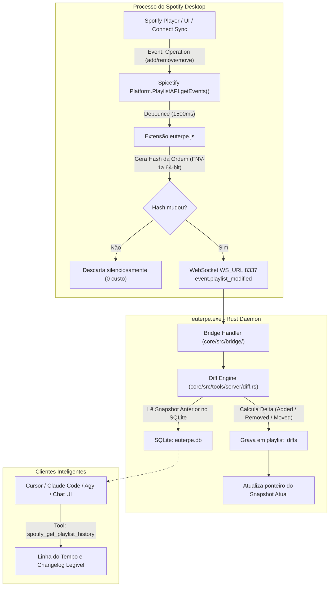

# Euterpe — Plano Diretor de Evolução: Event-Driven Playlist Diff & Versionamento Incremental

**Status:** Especificação Técnica Aprovada para Implementação  
**Versão Alvo:** Euterpe v2.3  
**Arquivos Afetados:**  
* `app/euterpe-extension/euterpe.js` (observador de eventos da PlaylistAPI / debounce)  
* `core/src/protocol/mod.rs` (evento `event.playlist_modified`)  
* `core/src/store/db.rs` (tabela `playlist_diffs` e índices de hash)  
* `core/src/store/snapshots.rs` (gerenciador de deltas e resolução de histórico)  
* `core/src/tools/server/diff.rs` (engine de cálculo Myers / LCS / Set Diff)  
* `agent/src/tools/defs.ts` (novas tools de inspeção de histórico para agentes)  

---

## 1. Contexto e Motivação

Atualmente, o Euterpe trabalha com snapshots estáticos ("Full Dumps") gerados exclusivamente de forma pessimista antes de mutações de agentes. 

Se o usuário:
1. Adiciona ou remove músicas manualmente no Spotify Desktop ou pelo celular (Spotify Connect);
2. Altera a ordem das faixas (reordenação manual de setlist);
3. Deleta músicas sem acionar o agente;

O snapshot anterior em banco fica desatualizado até a próxima mutação do Euterpe.

### O Desafio
Fazer *polling* periódico (consultar o Spotify a cada X segundos) consumiria CPU, memória e correria o risco de degradar a UI ou gerar gargalos desnecessários.

### O Princípio Arquitetural
**Zero-Polling & Push-Driven In-Memory Observation:**
O Spotify Desktop emite eventos internos reativos em memória através de seu barramento C++ / Platform API. A extensão Spicetify escuta esses eventos, aplica *debounce* e notifica o daemon Rust **apenas quando houver alteração real**.

---

## 2. Arquitetura da Solução



---

## 3. Especificação dos Componentes

### 3.1 Observador Reativo na Extensão (`app/euterpe-extension/euterpe.js`)

1. **Assinatura de Eventos da Playlist:**
   ```javascript
   const playlistEvents = platformApi("PlaylistAPI", "getEvents");
   if (playlistEvents && typeof playlistEvents.addListener === "function") {
     playlistEvents.addListener("operation", (ev) => {
       if (ev && ev.uri) handlePlaylistModified(ev.uri);
     });
   }
   ```
2. **Debounce Inteligente (1500ms):**
   Agrupa adições/remoções em massa ou reordenações contínuas de arrastar e soltar (drag & drop), disparando a sincronização apenas quando o usuário pausar a edição.
3. **Hashing Ultrarrápido no Client (FNV-1a):**
   Calcula a assinatura instantânea da lista ordenada de URIs:
   `hash = fnv1a64(uris.join(","))`
   O evento despachado ao daemon carrega:
   ```json
   {
     "type": "event.playlist_modified",
     "playlist_id": "37i9dQZF1DXcBWIGoYBM5M",
     "hash": "8f3b29a1c0d4e5f6",
     "uris": ["spotify:track:...", ...]
   }
   ```
   *Nota:* Como a leitura do array de faixas no client é feita em memória no Tier 1 (`PlaylistAPI.getContents`), **nenhuma chamada HTTP externa é feita**.

---

### 3.2 Protocolo WebSocket (`core/src/protocol/mod.rs`)

Adição da mensagem cliente $\rightarrow$ daemon:

```rust
#[derive(Debug, Clone, Deserialize, Serialize, PartialEq)]
#[serde(tag = "type")]
pub enum ClientMsg {
    // ... existentes ...
    #[serde(rename = "event.playlist_modified")]
    PlaylistModified {
        #[serde(rename = "playlistId")]
        playlist_id: String,
        hash: String,
        #[serde(default)]
        uris: Vec<String>,
    },
}
```

---

### 3.3 Esquema de Banco de Dados (`core/src/store/db.rs`)

Nova tabela de versionamento incremental no SQLite local:

```sql
CREATE TABLE IF NOT EXISTS playlist_diffs (
  id INTEGER PRIMARY KEY AUTOINCREMENT,
  playlist_id TEXT NOT NULL,
  parent_diff_id INTEGER,
  created_at INTEGER NOT NULL,
  hash TEXT NOT NULL,
  added_count INTEGER NOT NULL,
  removed_count INTEGER NOT NULL,
  reordered BOOLEAN NOT NULL,
  delta JSON NOT NULL, -- { added: [], removed: [], moved: [{ uri, from, to }] }
  FOREIGN KEY (parent_diff_id) REFERENCES playlist_diffs(id)
);

CREATE INDEX IF NOT EXISTS idx_playlist_diffs_pid ON playlist_diffs(playlist_id, id);
```

---

### 3.4 Algoritmo de Diff Engine (`core/src/tools/server/diff.rs`)

O algoritmo compara a lista anterior $A = [a_1, a_2, \dots, a_n]$ e a lista nova $B = [b_1, b_2, \dots, b_m]$:

1. **Conjunto Adicionado ($B \setminus A$):** Faixas que não existiam em $A$.
2. **Conjunto Removido ($A \setminus B$):** Faixas que deixaram de existir em $B$.
3. **Mapeamento de Posições (Reordenação):**
   Para cada faixa $t \in (A \cap B)$:
   Se $\text{index}_B(t) \ne \text{index}_A(t)$, registra:
   ```json
   { "uri": "spotify:track:123", "from_index": 4, "to_index": 1 }
   ```
4. **Vantagem de Armazenamento:**
   Se uma playlist de 1.000 músicas tiver apenas 1 faixa adicionada, o registro no banco armazena apenas `{"added":["spotify:track:..."]}` (~80 bytes), em vez de duplicar 1.000 strings de URIs (~35 KB).

---

### 3.5 Novas Ferramentas para Agentes (`agent/src/tools/defs.ts`)

```typescript
def(
  "get_playlist_history",
  "Consulta o histórico de alterações de uma playlist (changelog incremental com músicas adicionadas, removidas ou reordenadas ao longo do tempo).",
  {
    playlist_id: { type: "string", description: "ID ou URI da playlist" },
    limit: { type: "integer", description: "Quantidade de versões no histórico (default: 10)" }
  },
  ["playlist_id"],
  "server"
);

def(
  "compare_playlist_versions",
  "Gera um diff estruturado entre duas versões ou datas de uma playlist.",
  {
    playlist_id: { type: "string" },
    version_a_id: { type: "integer" },
    version_b_id: { type: "integer" }
  },
  ["playlist_id"],
  "server"
);
```

---

## 4. Roteiro de Execução (Fases de Implementação)

| Fase | Foco | Entregáveis | Validação |
|---|---|---|---|
| **Fase 5.1** | Banco & Diff Engine | • Tabela `playlist_diffs` em `core/src/store/db.rs`<br>• Módulo Rust `core/src/tools/server/diff.rs`<br>• Testes unitários com casos de adição, remoção e reordenação | `cargo test diff_engine` com 100% de cobertura nos algoritmos de delta |
| **Fase 5.2** | Eventos Spicetify | • Listener reativo em `app/euterpe-extension/euterpe.js`<br>• Hashing FNV-1a<br>• Debounce de 1500ms | Alteração manual no Spotify Desktop dispara evento sem travar a UI |
| **Fase 5.3** | Bridge & Protocolo | • Recepção de `event.playlist_modified` no daemon<br>• Filtro de hash prévio (descarta sem I/O se hash idêntico)<br>• Persistência do delta no SQLite | Teste de paridade WS em `tests/parity_bridge.rs` |
| **Fase 5.4** | Ferramentas MCP | • Implementação de `spotify_get_playlist_history`<br>• Exportação para os goldens e MCP catalog | Agente consegue responder "O que mudou na minha playlist?" em linguagem natural |

---

## 5. Critérios de Aceite e Garantias Não-Funcionais

1. **Zero Polling:** Nenhum `setInterval` ou laço de consulta ativa rodando no client ou no daemon.
2. **Zero Web API Rate Limit:** Todas as extrações pós-evento usam a memória de processo do Spotify Desktop (`Platform.PlaylistAPI`), com zero chamadas para `api.spotify.com`.
3. **Idempotência de Hash:** Modificações nulas (ou eventos de foco na janela do Spotify) não geram registros duplicados.
4. **Retrocompatibilidade:** O comando `undo_last_mutation` existente continua funcionando normalmente, agora também capaz de navegar pela timeline de diffs.
